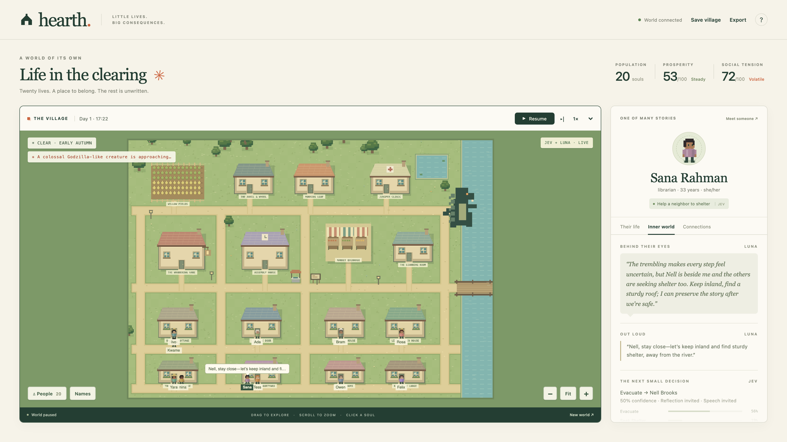

# Hearth

A pixel-art village of 20 people. Jev, TypeSafe's decision model, chooses what each villager does; OpenAI's Luna (`gpt-6-luna`) writes what they think and say. A Python engine runs the world and rejects any choice the rules don't allow.



## Run it

Python 3.11 or newer. From the repository root:

```sh
python3 -m venv .venv
.venv/bin/pip install -r village/requirements.txt
cp village/.env.example .env      # then add your own keys
.venv/bin/python -m village.server
```

Open http://127.0.0.1:8765 and press Play. The village saves itself to `village/data/village.json`, which git ignores.

Live mode needs three keys in `.env`:

| Variable | Used for |
| --- | --- |
| `CLOUDFLARE_ACCOUNT_ID`, `CLOUDFLARE_API_TOKEN` | Jev decisions through Cloudflare Workers AI |
| `OPENAI_API_KEY` | Luna thoughts, speech and scenario interpretation |

Without keys, or with `--demo`, Hearth runs on local rules and scripted prose and makes no model calls:

```sh
.venv/bin/python -m village.server --demo
```

## Tests

```sh
.venv/bin/pip install pytest
.venv/bin/python -m pytest village/tests -q
```

The tests make no network calls.

## More

- [village/README.md](village/README.md): how the model loop, rate limits, scenarios and saves work
- [village/ACTIONS.md](village/ACTIONS.md): the 89 actions villagers can take
- [village/VALIDATION.md](village/VALIDATION.md): what has been checked live, and how
- [village/presentation/DESCRIPTION.md](village/presentation/DESCRIPTION.md): a short description for slides
